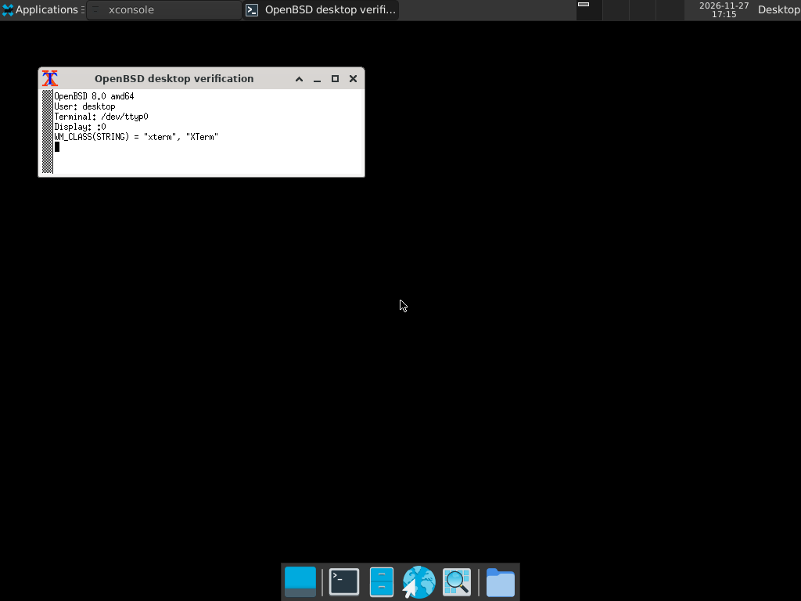

# OpenBSD 8 desktops for VirtualBox

Choose Xfce, GNOME, KDE Plasma, or cwm. Each download contains a separate virtual hard disk with OpenBSD 8.0 and one desktop already installed. Attach the disk in VirtualBox and sign in.

**Companion project** · [FreeBSD 15 desktops for VirtualBox](https://github.com/AlfredoLlaquet/FreeBSD15-VM-for-VirtualBox)

Created and directed by **Alfredo Llaquet-Alsina**. Implemented by **ChatGPT**.

## Choose your desktop

All four disks were tested in **VirtualBox 7.2.22**. The download size includes every archive part.

| Edition | What you get | Recommended RAM | Download |
| --- | --- | ---: | --- |
| Xfce | A familiar panel, applications menu, and Thunar file manager. | 3 GiB | [ZIP · 1.49 GB](https://github.com/AlfredoLlaquet/OpenBSD8-VM-for-VirtualBox/releases/download/openbsd-8.0-xfce-public-45953251746-1/OpenBSD-8.0-Xfce-amd64.zip) |
| GNOME | An Activities overview, searchable apps, and the Files browser. | 6 GiB | [1 part · 1.52 GB](https://github.com/AlfredoLlaquet/OpenBSD8-VM-for-VirtualBox/releases/tag/openbsd-8.0-gnome-46052866705-1) |
| KDE Plasma | A customizable panel, Dolphin file manager, and Konsole terminal. | 6 GiB | [2 parts · 2.45 GB](https://github.com/AlfredoLlaquet/OpenBSD8-VM-for-VirtualBox/releases/tag/openbsd-8.0-plasma-46052053042-1) |
| cwm | A charcoal desktop with keyboard shortcuts, a slim panel, and a live system monitor. | 3 GiB | [1 part · 1.30 GB](https://github.com/AlfredoLlaquet/OpenBSD8-VM-for-VirtualBox/releases/tag/openbsd-8.0-cwm-46047375931-1) |

## Set up VirtualBox

You need VirtualBox on a 64-bit Intel or AMD computer. These are x86-64 guests. VirtualBox on an Apple silicon Mac or an ARM-based Windows computer requires a different guest architecture. **Host** means your normal computer. **Guest** means the OpenBSD desktop inside the VM window.

1. **Download one edition.** On its release page, expand **Assets**. For a ZIP, extract it normally. For a numbered 7-Zip archive, download every file ending in `.7z.001`, `.002`, and so on into one folder. Open the first part with 7-Zip or an archive manager that supports split 7z files, and extract once. GitHub’s **Source code** links contain the build scripts. The extracted **`.vdi`** is the installed disk. Keep it in a permanent folder.
2. **Create the machine.** In VirtualBox Manager, click **New**, give the VM a name such as **OpenBSD Plasma**, and select **BSD → OpenBSD (64-bit)**. Leave **ISO Image** empty. Set **2 processors** and the memory shown above. In VirtualBox, 3 GiB is **3072 MB** and 6 GiB is **6144 MB**. Leave **EFI/UEFI** unchecked. Choose **Use an existing virtual hard disk file** if offered. Otherwise, finish the wizard and attach the disk in the next step.
3. **Attach the disk.** With the machine powered off, open **Settings → Storage**. Switch to **Expert** view if necessary. Find **Controller: AHCI** or add an **AHCI (SATA)** controller. If the wizard placed the extracted VDI under **Controller: IDE**, drag its entry onto **Controller: AHCI**. To attach it manually, select the AHCI controller, click **Add Hard Disk**, then **Add** to locate the VDI and **Choose**. Remove the attachment of any blank disk the wizard created. The downloaded VDI should be the only hard disk, on **AHCI port 0**. The empty IDE optical drive can stay where it is.
4. **Set the remaining hardware.** Use the settings in the table below. Click **OK**, select the VM, and click **Start**.
5. **Sign in as `desktop`.** Enter the password from the next section and press **Enter**. Password fields can stay blank while you type. The initial keyboard layout is US English.

| VirtualBox setting | Value |
| --- | --- |
| System → Motherboard | Legacy BIOS, I/O APIC enabled |
| System → Pointing Device | USB Tablet. Enable the USB controller if prompted. USB 1.1 (OHCI) is sufficient. |
| Display → Screen | VBoxVGA, 64 MB for the original Xfce image and 128 MB for the other editions, 3D acceleration off |
| Network → Adapter 1 | NAT, Intel PRO/1000 MT Desktop (82540EM), Cable Connected |

## Sign in and change the passwords

| Account | Public initial password | Purpose |
| --- | --- | --- |
| `desktop` | `OpenSesame` | Graphical login and everyday work |
| `root` | `CheckOut_TheCrumbs.org` | System administration through `su -` |

In a terminal, run `passwd` to change the desktop password. Then run `su -`, enter the initial root password, and run `passwd` again to set your own root password. Type `exit` to return to the desktop account. Do this before enabling incoming network access.

## Using your edition

### Xfce

Open the applications menu on the panel. Thunar manages files. **Alt+F2** opens the launcher, where you can type `xterm`. Use the logout menu to shut down.

The original Xfce disk was tested in VirtualBox 7.2.22 on FreeBSD 15 and Ubuntu 24.04 hosts. The Ubuntu check signed in through xenodm, opened an interactive xterm, fetched data over HTTPS, and rebooted back to the greeter. Its ZIP is about **1.49 GB**. The extracted VDI initially occupies about **4.4 GB** and can grow to **16 GiB**. [Original release and offline instructions.](https://github.com/AlfredoLlaquet/OpenBSD8-VM-for-VirtualBox/releases/tag/openbsd-8.0-xfce-public-45953251746-1)



[VirtualBox verification run](https://github.com/AlfredoLlaquet/OpenBSD8-VM-for-VirtualBox/actions/runs/46039718550)

### GNOME

Press **Super** (the Windows or Command key sent to the guest) for the Activities overview. Start typing an application name to find it. **Files** opens your home folder. Search for **Tour** for a guided introduction. The system menu at the top right contains the power controls.

GNOME Shell `49.10p2`. The extracted VDI initially occupies **7.1 GB** on the host and can grow to **48 GiB**. Use **6 GiB** for GNOME. At **4 GiB**, the greeter appeared, but the user’s GNOME Shell did not start within the five-minute check. [Release files and verification report.](https://github.com/AlfredoLlaquet/OpenBSD8-VM-for-VirtualBox/releases/tag/openbsd-8.0-gnome-46052866705-1)

<details>
<summary>View the GNOME desktop</summary>


</details>

### KDE Plasma

Use the application launcher on the panel or press **Alt+Space** to search. **Dolphin** manages files, **Konsole** opens a terminal, and **System Settings** controls the desktop’s appearance.

Plasma Workspace `6.7.5`. The extracted VDI initially occupies **10.6 GB** on the host and can grow to **48 GiB**. At **4 GiB**, one test reached the desktop and another showed the wallpaper without its panel. Use **6 GiB** for Plasma. [Release files and verification report.](https://github.com/AlfredoLlaquet/OpenBSD8-VM-for-VirtualBox/releases/tag/openbsd-8.0-plasma-46052053042-1)

<details>
<summary>View the KDE Plasma desktop</summary>


</details>

### cwm

Press **Super+P**, type a program name, and press **Enter**. The bottom panel shows open windows, the notification area, and the clock. Conky displays CPU, memory, and disk usage. The active window has a thin muted-gold border. **Super+F1** opens the shortcut guide inside the VM. To unlock, press **Space**, type the desktop password, and press **Enter**.

| Shortcut | Action |
| --- | --- |
| Super+Enter / Super+T | Open xterm / open or reattach tmux |
| Super+E / Super+M | Open PCManFM-Qt / Midnight Commander |
| Super+B / Super+L | Open Firefox / lock the screen |
| Print Screen | Save a PNG to `~/Pictures/Screenshots` |
| Alt+Tab / Alt+Shift+Tab | Cycle windows forward / backward |
| Super+F / Super+W | Toggle full screen / close the active window |
| Super+1 through Super+4 | Show a workspace |
| Super+Shift+1 through Super+Shift+4 | Move the active window to a workspace |
| Super+Shift+Q | Log out to the greeter |

The window manager is part of the OpenBSD 8.0 base system. The extracted VDI initially occupies **6.4 GB** on the host and can grow to **48 GiB**. [Release files and verification report.](https://github.com/AlfredoLlaquet/OpenBSD8-VM-for-VirtualBox/releases/tag/openbsd-8.0-cwm-46047375931-1)

<details>
<summary>View the cwm desktop</summary>


</details>

### Shut down or troubleshoot

Use the desktop’s power menu when available. From any edition, run `su -` in a terminal, enter the root password, then run `shutdown -p now`. Wait until VirtualBox reports **Powered Off** before copying a disk. Your next start retains your files and settings.

| Symptom | What to check |
| --- | --- |
| No bootable medium, or an installer starts | Attach the extracted VDI to AHCI port 0, leave the optical drive empty, and turn EFI off. |
| The desktop does not appear | Check the graphics controller, video memory, 3D setting, and the edition’s RAM. |
| The mouse is captured | Select USB Tablet. The Host key shown at the bottom of the VM window releases captured input. |
| Login fails | Check capitalization and the US keyboard layout. The root password contains both an underscore and a period. |
| No network | Recheck NAT, the Intel adapter model, and Cable Connected. |
| VirtualBox reports a duplicate disk UUID | Use VirtualBox’s **Clone** command when making an independent copy of an already registered VM. |

## Nerd Section

### How the image is prepared and verified

When you open xterm in the Plasma edition, the program itself came from OpenBSD’s installation CD. KWin, installed later from the package collection, draws its window border. The letters you type arrive from a keyboard emulated by VirtualBox. Each piece followed a different path onto your screen. The release test brings them together by typing a command into that very window and checking who received it.

#### An unattended installation from signed media

The build starts with the same `install80.iso` an amd64 machine can boot from. Before starting QEMU, the builder obtains OpenBSD’s `SHA256.sig` and uses `signify` with a copy of the **OpenBSD 8.0 base public key** pinned in the build script. The signature authenticates the list of expected hashes. Hashing the downloaded ISO then establishes that this particular file matches the entry OpenBSD signed. The public key is what lets the builder trust the answer even when the ISO and the checksum list came from the same mirror. [Installer source](build_guest.py) · [OpenBSD installation guide](https://www.openbsd.org/faq/faq4.html) · [signify manual](https://man.openbsd.org/signify.1)

On an OpenBSD system with the trusted 8.0 base key installed, the underlying check can be repeated in a directory containing the two downloaded files.

```sh
signify -C -p /etc/signify/openbsd-80-base.pub -x SHA256.sig install80.iso
```

On the Ubuntu build host, QEMU presents a virtual amd64 computer to OpenBSD and boots the verified ISO. The build script selects the serial console and gives the installer the address of an answer file served by a temporary HTTP server on the build host. The file tells the installer which disk to use, how to partition it, which accounts to create, and where to find the distribution sets. The answer to that last question is `cd0`. All sets, including the X Window System shipped by OpenBSD as Xenocara, come from the authenticated CD image. That also explains the surprising “Continue without verification” answer in the script. The full install CD omits a separate signed manifest for its embedded sets, and the host has already verified the entire ISO.

Once the installed system boots, two OpenBSD tools take over. `syspatch` applies available signed binary fixes to the base system. `pkg_add` obtains the selected desktop and applications from the OpenBSD 8.0 package collection. An X server, a window manager, and a desktop suite can therefore have different origins even when they appear on the same screen. Xenocara and cwm arrive with the system. GNOME Shell, Plasma Workspace, and Firefox arrive as packages. [Package installation script](guest/packages.sh)

The original **Xfce** download has its own history. Its public ZIP was made by refreshing the accounts and documentation on the existing installed disk. Its fresh-install recipe is still available in the repository. When the other three editions were added, the project downloaded that same ZIP, checked the ZIP and VDI hashes, and booted a copy in VirtualBox 7.2.22. That exercise tested the disk early readers had actually downloaded. [Xfce refresh workflow](.github/workflows/refresh.yml) · [Verification of the published ZIP](.github/workflows/legacy-proof.yml)

#### What must finish before the power goes off

For GNOME, Plasma, and cwm, package installation ends with a powered-off disk in QCOW2, QEMU’s copy-on-write format. The build keeps this **checkpoint** so a change to the login configuration can be tested without downloading the packages again. Configuration writes go into a small copy-on-write disk called an *overlay*. Reads of an unchanged block go to the checkpoint. A write to that block belongs to the overlay. At this stage both files are needed to see the configured system.

One detail matters particularly on OpenBSD. During startup the system relinks its kernel in the background, preparing a newly arranged kernel for the **next** boot. A current boot that looks healthy says little about the file the bootloader will read tomorrow. Before powering down, the provisioning script waits for the relinker, checks its success message, and verifies `/bsd` against `/var/db/kernel.SHA256`. If that check fails, it retries the native relinker once. The script also switches the boot console from the serial port back to `pc0` so the next operator sees OpenBSD in the VM window. [Guest provisioning and kernel checks](guest/provision.sh)

After a clean shutdown, `qemu-img convert` reads the overlay and its backing disk together and writes a standalone Virtual Disk Image (VDI) for VirtualBox. `qemu-img compare` then compares what the guest can read at corresponding disk addresses. The QCOW2 and VDI headers describe different formats, so whole-file hashes of those two files would answer the wrong question. Sector comparison establishes that the conversion preserved the virtual disk’s contents. The project takes a SHA-256 hash of the resulting **VDI** for later byte-for-byte checks. [QEMU disk image tools](https://www.qemu.org/docs/master/tools/qemu-img.html) · [Checking the downloaded VDI](#checking-the-copy-you-downloaded)

#### Making VirtualBox prove that someone can use the desktop

The next machine runs **VirtualBox 7.2.22**. It cold-boots an independent copy of the exported VDI. Even registering a disk can update its VDI header. Using a copy lets the test log in, create files, and reboot while the original retains its release checksum. A temporary SSH connection forwarded through the host’s loopback address lets the verifier inspect the guest. The virtual keyboard delivers the keystrokes, and the virtual monitor shows what a person at the console would see. [VirtualBox configuration](editions/vbox.py) · [Desktop verifier](editions/check.py)

Consider Plasma. The verifier types the public account and password at the graphical greeter. It looks for `kwin_x11`, the window manager, and `plasmashell`, which supplies the workspace. Both must belong to `desktop`. It then asks X11 whether a panel window has appeared. A wallpaper can already be visible while that panel is still missing. Inside the session, the verifier opens an xterm and types `tty` and `id -un` into it, redirecting the output to a temporary file. SSH reads back the result. On the published disk the terminal reported `/dev/ttyp1` and the account was `desktop`. The device name is assigned at runtime. What matters is that keystrokes delivered to a graphical window reached that user’s shell.

The same full test checks the address on `em0`, the default route, and an HTTPS fetch from the OpenBSD mirror. It requests a reboot, waits for `kern.boottime` to change, and finds the graphical greeter again. The cwm edition also has to open and close PCManFM-Qt with cwm shortcuts and lock and unlock the session. The original Xfce verifier has its own path through xenodm, the Xfce processes, a visible interactive xterm, networking, and a second boot. [Original Xfce verifier](verify_desktop.py)

Memory trials explain the settings at the top of this README. At 4 GiB, GNOME reached the greeter but failed to start the user’s shell within the test window. One Plasma trial reached the desktop at 4 GiB, while another displayed the wallpaper without its panel. Both editions completed the full interactive test at 6 GiB. These observations explain the 6 GiB recommendation for these images. They also show how much a test can miss if it stops at the first attractive screen. [GNOME results](https://github.com/AlfredoLlaquet/OpenBSD8-VM-for-VirtualBox/releases/tag/openbsd-8.0-gnome-46052866705-1) · [Plasma results](https://github.com/AlfredoLlaquet/OpenBSD8-VM-for-VirtualBox/releases/tag/openbsd-8.0-plasma-46052053042-1)

### Reading the disk from inside OpenBSD

The Plasma download is 2.45 GB across two compressed parts. Extract it and the VDI occupies 10,604,446,208 bytes on the host. Boot it and OpenBSD sees a **48 GiB disk**. All three measurements are right. The download is measured in decimal GB (one billion bytes each). The disk capacity is measured in binary GiB (1,073,741,824 bytes each). The dynamically allocated VDI grows as the guest writes to previously unallocated blocks. The virtual capacity is the address space the controller presents to OpenBSD. The original Xfce disk has 16 GiB of virtual capacity. GNOME and cwm use the same 48 GiB capacity as Plasma.

Inside that disk is a master boot record (MBR) with an OpenBSD partition. An OpenBSD *disklabel* subdivides that space into swap and the filesystems mounted at `/`, `/tmp`, `/var`, `/usr`, `/usr/local`, and `/home`. This becomes practical when an application installer reports that it has run out of space. Most packaged applications live under `/usr/local`. In the Plasma test, that filesystem had 12.4 GiB available, while the root filesystem had 1.7 GiB. Asking `df -h /` whether Firefox will fit is like asking the ground-floor tenant how much room is left in the attic. [OpenBSD disk setup](https://www.openbsd.org/faq/faq14.html)

```sh
df -h / /usr/local /home
mount
```

The first command selects the filesystems containing those paths. The second shows their device names and mount options. In a root shell, `disklabel sd0` shows the partition boundaries, including swap, which never appears in `df`. On a running system, `syspatch -l` lists installed base patches and `pkg_info` lists installed packages. For maintenance, root runs `syspatch` for the base system and `pkg_add -u` for packages, following any reboot instructions from `syspatch`.

### From the login window to the four desktops

The **display manager** presents the greeter, authenticates the user, and launches a session. A **window manager** takes responsibility for the application windows inside that session. A desktop environment can add a panel, a file manager, and services of its own. Knowing which component owns the screen gives you somewhere to look when a login succeeds but the desktop looks incomplete.

| Edition | What happens after authentication |
| --- | --- |
| Xfce | OpenBSD’s xenodm reads `~/.xsession`. The installed launcher starts Xfce with ConsoleKit. `xfwm4` manages the windows and `xfce4-panel` draws the panel. The original inventory records `xfce4-session-4.20.4`. |
| GNOME | GDM starts the packaged GNOME Xorg session. The system message bus starts before GDM. The greeter has its own `_gdm` settings, and the user gets a separate GNOME Shell. This distinction lets the build configure the name prompt at login and the welcome tour on the desktop independently. The inventory records `gnome-shell-49.10p2`. |
| KDE Plasma | xenodm starts `~/.xsession` under the user’s `kde` login class. The script creates a private runtime directory and starts `startplasma-x11` with ConsoleKit and a per-session D-Bus. The session requests software OpenGL and disables KWin compositing for this virtual display. The inventory records matching Plasma Workspace and KWin X11 packages at `6.7.5`. |
| cwm | xenodm starts a short shell script that brings up the panel and other X11 clients, then hands control to OpenBSD’s own cwm. The script is small enough to follow from login to logout. |

D-Bus carries messages between programs. The system bus serves machine-wide services. The session bus gives programs running as the logged-in user a place to discover and talk to one another. In the Plasma startup script, ConsoleKit associates the login with a local session, then `dbus-run-session` supplies the bus for the workspace and its applications. [Desktop startup scripts](guest/edition-desktop.sh) · [GDM configuration](guest/gdm.sh)

### A small X11 desktop you can take apart

Follow **Super+P** in the cwm edition. In `~/.cwmrc` the binding is named `4-p`, where `4` means the Mod4 key mapped to Super. It runs `mvm-launch`, which calls `dmenu_run` with a font and four colors. dmenu suggests executable names from the search path and launches the selection. The panel plays no part in this shortcut. Changing a launcher color and changing the focused window’s gold border therefore take you to two different files. [Window manager bindings](guest/cwm/home/.cwmrc) · [Launcher](guest/cwm/bin/mvm-launch)

At login, the session script loads `~/.Xresources` for xterm, asks GTK applications to prefer dark colors, and paints the wallpaper with feh. The gold seam in that wallpaper is drawn by a few lines of `awk` that write a portable pixmap. tint2 supplies the panel, Conky draws system statistics, dunst displays notifications, and Parcellite remembers clipboard entries inside the guest. Picom combines X11 window surfaces using XRender, with shadows and fading disabled. The final `exec cwm` makes cwm the foreground session process. Quitting it returns you to the greeter. [Session script](guest/cwm/bin/mvm-cwm-session) · [Wallpaper generator](guest/cwm/install.sh)

The visual settings follow the component that reads them. xterm reads its green palette and JetBrains Mono font from X resources. PCManFM-Qt reads the Qt style through `qt6ct`. GTK applications have their own settings, which LXAppearance can help edit. The panel, Conky, and Picom each read a file under `~/.config`. A running guest can show you which font matched with `fc-match "JetBrains Mono"`. The same release report also checks for the Poppler plugin that gives Zathura its PDF support. [Configuration files](guest/cwm/home/.config) · [Keyboard guide](guest/cwm/KEYS.txt)

The Print Screen binding points to another small script. It creates the screenshots directory if necessary and invokes `scrot` with a timestamped PNG name. The rest of the workbench uses ordinary applications you can also run by name. There is Vim in a terminal and Geany in a graphical window, Firefox for the web, mpv for media, and Fastfetch for a one-time system summary beside Conky’s live view. [Screenshot script](guest/cwm/bin/mvm-screenshot)

### Hardware, networking, and the identity of a copy

A VDI carries the installed operating system. VirtualBox supplies the virtual motherboard and attached devices. Legacy BIOS starts the bootloader, the AHCI controller exposes the disk as `sd0`, and OpenBSD recognizes the emulated Intel Ethernet adapter as `em0`. A USB tablet reports absolute positions, so the host can point at a particular spot in the guest. This works with OpenBSD’s own input support. OpenBSD has no Oracle Guest Additions, so file transfers use a network service and the guest controls the available display resolutions. [VirtualBox 7.2 User Guide](https://docs.oracle.com/en/virtualization/virtualbox/7.2/user/)

OpenBSD reads `inet autoconf` from `/etc/hostname.em0`. VirtualBox’s NAT supplies a lease and handles outgoing traffic. In the published Plasma test, `ifconfig em0` showed `10.0.2.15` and `route -n get default` showed `10.0.2.2` as the gateway. That address belongs to the guest’s virtual network. Incoming SSH requires a deliberate forwarding rule or a different network configuration. The build removes its saved lease and SSH host keys. Each copy requests a lease and generates its own server keys. Two guests on separate VirtualBox NAT networks can legitimately receive the same private IP address. The `desktop` account belongs to `wheel` for local administration through `su -`. Direct root SSH login is disabled.

### Checking the copy you downloaded

For GNOME, Plasma, and cwm, `SHA256SUMS-downloads.txt` identifies each compressed volume. With all volumes and that file in one directory, Linux can check them with `sha256sum -c SHA256SUMS-downloads.txt`. FreeBSD or OpenBSD can print a file’s digest with `sha256 filename`, macOS with `shasum -a 256 filename`, and Windows PowerShell with `Get-FileHash filename -Algorithm SHA256`. Compare all 64 hexadecimal digits with the matching entry. The original Xfce ZIP has a [separate ZIP checksum](https://github.com/AlfredoLlaquet/OpenBSD8-VM-for-VirtualBox/releases/download/openbsd-8.0-xfce-public-45953251746-1/OpenBSD-8.0-Xfce-amd64.zip.sha256).

Every archive contains `SHA256SUMS` for the extracted VDI. Check it **before the first boot**, while your copy still has the published bytes. The newer releases also include `PACKAGES.txt` for exact package versions, `verification.txt` for the full test, and, for GNOME and Plasma, `4096-MiB.txt` for the shorter login trial. The three screenshots show the greeter, desktop, and terminal as seen by the virtual monitor. `IMAGE-INFO.txt` connects those observations to a source commit, build runs, disk size, and hash. The original Xfce inventory is included with its ZIP. These download hashes establish that your files match this project’s release. The OpenBSD signature at the start of the build authenticates the upstream installer.

For maintainers following the numbered releases, **Prepare desktop packages** produces an edition-specific checkpoint retained for two days. The release workflow accepts that run ID or selects the newest available matching checkpoint on `main`. It verifies the original VDI’s hash after testing, tests the archive, hashes the VDI streamed back out of it, and compares each uploaded asset’s size and SHA-256 with the local file before publishing. A later build can receive newer packages. To identify exactly what ran in a particular release, start with that release’s inventory and report. [Preparation workflow](.github/workflows/prepare.yml) · [Release workflow](.github/workflows/release.yml) · [Packaging script](editions/package.sh)

## License

The project’s original scripts, workflows, configuration, and documentation use the [Unlicense](LICENSE). The operating system and bundled applications retain their individual licenses. [Third-party notices](THIRD-PARTY-NOTICES.txt).

### Alfredo Llaquet-Alsina is not only a BSD enthusiast, but also a writer. Please visit [www.TheCrumbs.org](https://www.thecrumbs.org/) and take a look at his work, free for everyone.
